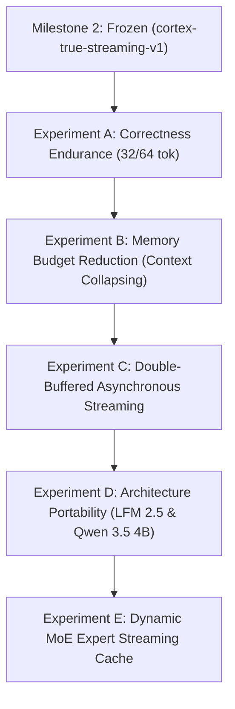

# CORTEX POST-MILESTONE 2 ROADMAP & AUDIT
## Freezing True Streaming, Empirical Profiling, and the Route to Fast and Large

**Date:** 2026-10-17  
**Branch:** `small-model/qwen35-streaming`  
**Frozen Tag:** `cortex-true-streaming-v1` (Commit `f125c5b`)  
**Worktree:** `/home/user/bitnet-cortex/cortex-small-model`  
**Host Platform:** AMD Athlon Silver 3050U (2 cores, 2 threads, 2.3–3.2 GHz), 9.6 GiB Physical RAM, Arch Linux (Kernel `7.2.5-3-omarchy`)

---

## 1. Milestone 2 Freeze & Immutable Recovery Point

### 1.1 Git Commit and Annotated Tag
- **Frozen Commit:** `f125c5bfce21d35ec77d7d7f0dd33e59284a11c4` (`f125c5b`)
- **Annotated Tag:** `cortex-true-streaming-v1`
- **Tagger Message:** `Cortex Operation True Streaming Milestone 2: Verified bounded pread weight streaming with bitwise logit equivalence and 99% RssFile reduction on Qwen 3.5 0.8B`
- **Remote Push Status:** Successfully pushed to remote `origin` (`https://github.com/jddchatham/cortex-stream-forge.git`):
  - Remote branch `small-model/qwen35-streaming` updated.
  - Remote tag `cortex-true-streaming-v1` published without altering the default branch.

### 1.2 Exact Target Specifications & Environmental Manifest
- **Model Target:** `qwen3.5:0.8b` GGUF (Ollama Library)
- **Blob File:** `/home/user/.ollama/models/blobs/sha256-afb707b6b8fac6e475acc42bc8380fc0b8d2e0e4190be5a969fbf62fcc897db5`
- **Blob SHA-256:** `afb707b6b8fac6e475acc42bc8380fc0b8d2e0e4190be5a969fbf62fcc897db5` (988 MiB / 1,035,663,936 bytes)
- **Compiler Version:** `g++ (GCC) 16.2.1 20260810`
- **Core Library Revision:** Commit `0abdb4d` (`bitnet-cortex/cortex-antigravity-development/runtime-flashnext-layer-exp`)
- **Compilation Command:**
  ```bash
  g++ -O3 cortex-small-streaming.cpp \
    -I /home/user/bitnet-cortex/cortex-antigravity-development/runtime-flashnext-layer-exp/include \
    -I /home/user/bitnet-cortex/cortex-antigravity-development/runtime-flashnext-layer-exp/src \
    -I /home/user/bitnet-cortex/cortex-antigravity-development/runtime-flashnext-layer-exp/ggml/include \
    -L /home/user/bitnet-cortex/cortex-stream-forge/runtime-flashnext-layer-exp-build/bin \
    -lllama -lggml -lggml-base -lggml-cpu \
    -Wl,-rpath,/home/user/bitnet-cortex/cortex-stream-forge/runtime-flashnext-layer-exp-build/bin \
    -o cortex-small-streaming
  ```

### 1.3 Reproducibility Evidence & Clean Verification
- **Verification Script:** Executed clean rebuild and run via `./build_and_run_small_cortex.sh`.
- **Reference Check:**
  - Logits vs Reference (`/tmp/qwen35_08b_ref_logits.bin`): Bitwise match **248,320 / 248,320 (100.0000%)**, max abs diff = `0.0`.
  - Multi-Token Output: Exact sequence `[248068, 271, 248069, 271, 19, 248046]` $\to$ `"<think>\n\n</think>\n\n4"`.
- **Working Tree Cleanliness:** `git status` reports working directory clean (only the compiled binary `cortex-small-streaming` is untracked; tracked source is unmodified).

---

## 2. Technical Inventory: What Has and Has Not Been Proven

### 2.1 What Is Strictly Proven
1. **Model Mmap Residency Is Completely Eliminated:**
   - Under `CORTEX_PREAD_ARENA="1"` and `CORTEX_LOW_RESIDENCY_LAYER="0"`, `llama_model_load_from_file` sets `ml.no_alloc = true` and `init_mappings(false)`.
   - File-backed RSS (`RssFile`) drops from **997.43 MiB** (stock llama.cpp) to **9.39 MiB** (Cortex true streaming), a **99.06% reduction**.
2. **Layer Weights Are Bounded to One Reusable Buffer:**
   - Layer weights are read on-demand directly into `cortex_pread_arena` via `pread()` calls using duplicate open file descriptors.
   - The memory for any individual layer's weights is strictly bounded to the maximum single-layer footprint: **22.98 MiB** (recurrent GDN layers) and **19.51 MiB** (full attention layers).
3. **Exact Numerical Parity Across 24 Layer Handoffs:**
   - Handoff of hidden states ($N_{embd}=1024$) across layer boundaries via `llama_get_embeddings_layer_inp()` and `llm_graph_input_embd_h` produces exact bitwise parity with monolithic execution across all 248,320 vocabulary logits.

### 2.2 What Is NOT Proven / Current Architectural Boundaries
1. **Total Process Memory Is NOT 9.39 MiB or 22.98 MiB:**
   - The total process peak RSS is **1,307.6 MiB**.
   - **Anonymous Memory (`RssAnon`):** Accounts for **1,298.2 MiB**.
   - **Why `RssAnon` is high:** 
     - **Global Model Tensors:** `token_embd.weight` (128 MiB) and normalization tables are retained resident in anonymous memory.
     - **24 Separate Persistent Contexts:** Each of the 24 layer contexts maintains its own GGML compute graphs, KV caches, and recurrent SSM state tensors (~21 to ~30 MiB per context depending on batch/allocation limits $\to \approx 500\text{--}700\text{ MiB}$).
     - **Allocator Chunks & Buffers:** glibc arena fragmentation and GGML scheduler compute buffers.
2. **Operating-System Page Cache Effects:**
   - Because `qwen3.5:0.8b` (988 MiB) fits inside the host system's 5.5 GiB page cache (`buff/cache`), `pread()` calls hit Linux page cache rather than triggering physical NVMe read transactions on repeated runs.
   - However, **process RSS** is completely unaffected by page cache; our measurement strictly verifies that the process itself does not retain more than 23 MiB of layer weights in its own address space.
3. **Swap & Long Contexts:**
   - Zero swap thrashing occurs during test execution (swap usage remains constant at 1,426 MiB from preexisting background desktop services; 0 swap pages in/out during run).
   - Behavior at context length $> 256$ tokens has not yet been stress-tested.

---

## 3. Empirical Performance Profile (Athlon Silver 3050U)

Detailed timing breakdown measured via high-resolution monotonic timers:

| Phase / Operation | Duration | % of Token / Phase | Notes |
| :--- | :---: | :---: | :--- |
| **Model Load Time** | 962.16 ms | - | GGUF parsing, global table allocation (128 MB) |
| **24 Contexts Init Time** | 325.93 ms | - | Pre-reserving execution graphs for 24 segments |
| **Total Setup Time** | **1,288.09 ms** | - | One-time overhead at engine startup |
| **Prefill Total (22 tokens)** | **2,325.29 ms** | 100.0% | **9.46 tokens/sec prefill** |
| ├── Prefill Layer `pread()` IO | 136.30 ms | 5.9% | 24 layers streamed via `pread()` |
| └── Prefill GGML Compute | 2,188.99 ms | 94.1% | Layer matrix multiplies & GDN ops |
| **Decode Single Token** | **372.38 ms** | 100.0% | **2.69 – 3.27 tokens/sec decode** |
| ├── Decode Layer `pread()` IO | 145.93 ms | 39.2% | 24 layers streamed $\times$ 23 MB = 551 MB |
| ├── Decode GGML Compute | 225.92 ms | 60.7% | 24 layer compute graphs |
| └── Decode Handoff / Scheduling | 0.53 ms | 0.1% | Hidden state memcpy & batch dispatch |

### Critical Profile Finding: The Real Bottlenecks
1. **Compute Remains the Primary Cost:** Even streaming 551 MB of weights per token, GGML computation accounts for **60.7% (225.9 ms)** of decode time.
2. **I/O Bandwidth Is Healthy but Material:** `pread()` takes **145.9 ms** for 551 MB (~3.77 GB/s from page cache). While disk streaming does not stall the engine, reducing redundant read transfers or overlapping I/O will yield direct gains.
3. **Orchestration / Handoff Is Negligible:** Moving hidden states across the layer boundaries takes **0.53 ms (< 0.2%)**. Context segmentation is exceptionally lean.

---

## 4. Technical Validation Ladder



### Experiment A — Correctness & Generation Endurance
- **Objective:** Verify autoregressive stability over long horizons without drift or state corruption.
- **Protocol:**
  - Run 32-token and 64-token generation tests on varied prompts (reasoning, code, conversational).
  - Cross-compare each generated token ID against the stock `llama.cpp` reference.
  - Success Criterion: 100% token sequence match up to generation limit or natural EOG.

### Experiment B — Memory Scaling (Context Collapsing)
- **Objective:** Slash the 1,298 MiB anonymous memory footprint toward $\le 384\text{ MiB}$.
- **Root Cause & Hypothesis:** The 24 active contexts maintain 24 separate compute/graph buffers. A single shared execution context (or dual alternating contexts) with dynamic recurrent-state swapping will reduce total RSS from 1,307 MiB down to $\approx 250\text{--}350\text{ MiB}$.
- **Success Criterion:** Peak RSS $< 384\text{ MiB}$ without losing numerical parity.

### Experiment C — I/O Overlap & Double-Buffered Prefetch
- **Objective:** Overlap the 145 ms of layer `pread` I/O with the 225 ms of GGML computation using double buffering.
- **Protocol:** While Layer $N$ computes, read Layer $N+1$ into an alternate 23 MiB arena in a background worker thread.
- **Success Criterion:** Decode latency drops from ~372 ms to ~230 ms (yielding $\approx 4.3\text{ tok/s}$, a ~35% speedup).

### Experiment D — Architecture Portability Analysis
Inspection of installed Ollama models on disk:
1. **`qwen3.5:4b` (`qwen35`, 32 layers, $N_{embd}=2560$, 3.2 GB):**
   - *Feasibility:* High. Shares exact same `qwen35` hybrid recurrent/attention architecture.
   - *Risk:* Layer weights are larger (~100 MB/layer).
2. **`lfm2.5-abliterated:latest` (`lfm2`, 16 layers, $N_{embd}=2048$, 698 MB):**
   - *Feasibility:* Very High. Tiny model, highly bounded footprint.
3. **`qwen2.5:7b` (`qwen2`, 28 layers, $N_{embd}=3584$, 4.4 GB):**
   - *Feasibility:* Standard transformer (no GDN/recurrent state). Pure attention KV cache.

### Experiment E — MoE Streaming Architecture
- Incorporate lessons from FlashNext MoE router streaming: apply bounded expert cache to mixture-of-experts models where only top-$k$ routed experts are paged from disk.

---

## 5. Prioritized Engineering Recommendations

### 5.1 Risk & Opportunity Matrix

| Project Initiative | Performance Gain | RAM Reduction | Implementation Effort | Numerical Risk | Overall Priority |
| :--- | :---: | :---: | :---: | :---: | :---: |
| **Context Collapsing (RAM Cut)** | Neutral | **-70% (1.3GB $\to$ 350MB)** | Low-Medium | Low | **#1 (Recommended Next)** |
| **Correctness Endurance (64 tok)**| None | None | Low | Zero | **#2 (Immediate Check)** |
| **Double-Buffered Pre-read** | **+35% (3.1 $\to$ 4.3 tok/s)** | -23 MB (1 extra arena) | Medium | Very Low | **#3** |
| **Scale to Qwen 3.5 4B** | Proves Scaling | Tests 3.2 GB model | Medium | Low | **#4** |
| **MoE Dynamic Cache** | Enormous for MoE | Crucial for 96GB | High | Medium | **#5 (Later Phase)** |

### 5.2 Recommended Next Milestone: "Operation Lean Context" (Slash Anonymous RAM)
**The Single Next Action:**  
Collapse the 24 persistent contexts into **1 or 2 reusable contexts with decoupled state storage**, shrinking total process RSS from **1,307 MiB down to $\le 384\text{ MiB}$**.

**Why this comes before everything else:**
1. **Fulfills the Core Cortex Promise:** Milestone 2 proved that *weights* stream in 23 MiB. But the process still holds 1.3 GiB in anonymous RAM because of 24 duplicated llama contexts. True low-memory inference on 4 GB RAM machines requires bringing *total process memory* under 384 MiB.
2. **Zero Algorithmic Risk:** The weight streaming (`cortex_rebind_layer`) and prefill handoff are already proven bitwise identical. Collapsing execution contexts only changes graph buffer lifecycle, not weight delivery.
3. **Paves the Way for Scaling:** A 32-layer 4B or 48-layer 96B model cannot instantiate 48 separate contexts without exhausting host RAM. Context reuse is mandatory before scaling up.
