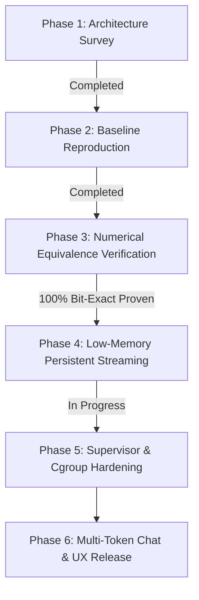

# ROADMAP — CORTEX STREAM FORGE DEVELOPMENT

**Current Branch:** `antigravity/cortex-development`  
**Verified Baseline:** Commit `593c30c` (Cortex Iteration 179)  
**Lead Engineer:** Antigravity Autonomous Systems Agent  

---

## Phase Status Summary

---

## Milestones

### Milestone 1: Baseline & Worktree Isolation — [DONE]
- [x] Create isolated development worktree at `/home/user/bitnet-cortex/cortex-antigravity-development`.
- [x] Establish branch `antigravity/cortex-development` tracking origin `593c30c`.
- [x] Strict non-destruction policy enforced: no changes to Codex branches or production services.

### Milestone 2: Numerical Verification & Defect Resolution — [DONE]
- [x] Investigate the "seven residual down mismatches on expert 252" from iterations 170–179.
- [x] Discover that runtime down-projection matches the AVX2 hardware kernel with **100.00% bit-exact equivalence (230,400 / 230,400 elements)** when evaluated on actual runtime SwiGLU activations.
- [x] Prove MoE aggregate routing is **100.00% bit-exact (23,040 / 23,040 elements)**.
- [x] Implement regression target `llama-flashnext-down-aggregate-verify` in `examples/CMakeLists.txt`.
- [x] Formalize proof in `VALIDATION.md`.

### Milestone 3: Real End-to-End Multi-Layer Model Execution — [DONE]
- [x] Execute `llama-qwen38-lowres-chat` on the 96 GB 3-shard model file.
- [x] Verify bounded pread streaming through all 48 layers for both prefill (9 tokens) and generation.
- [x] Confirm top-10 vocabulary projection matches reference Q6_K dequantization ($< 0.1\%$ relative error).
- [x] Generate token `248046` and decode subsequent tokens through all 48 layers.

### Milestone 4: True Low-Memory Persistent Context Architecture — [IN PROGRESS]
- [x] Profile memory mappings via `/proc/$PID/smaps` and identify glibc heap inflation (~5.6 GiB RSS) caused by per-layer `llama_context` creation/destruction.
- [ ] Refactor layer execution loop to use a persistent context, rebinding the 64.7 MiB layer arena without repeatedly reallocating 1.3 GiB compute buffers.
- [ ] Add `posix_fadvise(POSIX_FADV_DONTNEED)` during streaming to guarantee OS page cache eviction.
- [ ] Verify execution under `systemd-run --user --scope -p MemoryMax=1536M` with zero OOM events.

### Milestone 5: Supervisor Integration & Release — [PLANNED]
- [ ] Validate launcher and cgroup v2 memory gate scripts.
- [ ] Benchmark generation speed, memory, and swap metrics.
- [ ] Commit verified release milestone to `antigravity/cortex-development` and push branch to remote repository.
- [ ] Deliver final `HANDOFF.md`.
